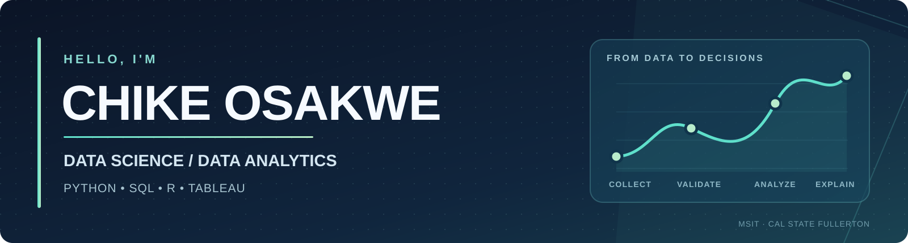

### Data Science & Data Analytics | M.S. Information Technology (Data Science), Cal State Fullerton | Python · SQL · R · Tableau

I'm a graduate student at **California State University, Fullerton**, pursuing an **M.S. in Information Technology with a concentration in Data Science**. I use Python, R, SQL, and visualization tools to investigate real questions, develop statistical and predictive models, and communicate findings that can inform decisions.

My portfolio brings together **machine learning, exploratory analysis, statistical modeling, SQL-based data preparation, and business intelligence**. I've worked with student retention data, World Bank development indicators, financial market returns, and operational datasets. I care as much about *whether a result is reliable and useful* as I do about the model or dashboard that produced it.

I also spent two years teaching mathematics and using student assessment data to help coordinate targeted interventions. That experience still influences how I approach analysis: understand the audience, question the metric, and make the findings actionable.

---

## Featured data science & analytics projects

### [Student Dropout Analysis](https://github.com/cosak001/student-dropout-analysis) | Python · scikit-learn · Tableau · SPSS

**Predictive modeling, model evaluation, and dashboard storytelling.** Analyzed a **600-record first-year student case dataset** to examine dropout patterns and compare logistic regression with a neural network. Rebuilt the models in Python using a stratified holdout set and five-fold cross-validation; logistic regression achieved **0.737 mean cross-validated ROC AUC**. Rather than relying on ~81% accuracy for an imbalanced outcome, tuned the decision threshold to improve **held-out dropout recall from 10% to 57%** (at **37% precision**). Built Tableau dashboards to communicate patterns in GPA, course load, and retention, while explicitly discussing selection bias in voluntary seminar attendance.

[**Explore the project →**](https://github.com/cosak001/student-dropout-analysis) · [**View the interactive Tableau dashboard →**](https://public.tableau.com/app/profile/chike.osakwe3768/viz/StudentDropoutAnalysis_17897246641970/StudentDropoutRiskPatterns)

### [Global Emissions & Economic Development](https://github.com/cosak001/worldbank-emissions-sql) | PostgreSQL · SQL · ETL

**Relational modeling, data transformation, and exploratory analysis.** Developed a reproducible PostgreSQL workflow covering **8 World Bank indicators across 200+ countries**, including CO₂ emissions, GDP per capita, inflation, and internet adoption. Used SQL staging tables, data cleaning, referential constraints, CTEs, and window functions to create **14 analytical views**. Added validation checks to distinguish country records from regional aggregates and test data completeness before interpreting the results.

[**Explore the SQL project →**](https://github.com/cosak001/worldbank-emissions-sql)

### [Mean-Variance Portfolio Optimization](https://github.com/cosak001/mean-variance-portfolio-optimization) | R · PostgreSQL · Docker

**Quantitative analysis, optimization, and out-of-sample evaluation.** Used historical returns from **15 securities** to construct a mean-variance-optimized portfolio and compare it with the S&P 500 Total Return index. Over a **58-trading-day out-of-sample backtest**, the portfolio returned **12.31% versus 6.20%** for the benchmark, with considerably greater volatility. The brief test period and risk differences are important limitations—not evidence of guaranteed future performance.

[**Explore the portfolio analysis →**](https://github.com/cosak001/mean-variance-portfolio-optimization)

### [Puglia Winery Business Intelligence & Data Warehouse](https://github.com/cosak001/pulgia-winery-bi-data-warehouse) | MySQL · Dimensional Modeling · BI

**Data warehousing and analytics-ready modeling.** Contributed to a team project organizing winery sales and production data around business reporting questions. Developed a **MySQL sample implementation** and documented a Kimball-style dimensional model, ETL requirements, and a proposed Power BI reporting design.

[**Explore the BI project →**](https://github.com/cosak001/pulgia-winery-bi-data-warehouse)

### [GPU Diagnostic & Bug Triage Toolkit](https://github.com/cosak001/gpu-triage-toolkit) | Python · Automation

**Python automation and structured diagnostic data.** Built a toolkit that runs reproducible GPU workloads, collects NVIDIA telemetry, flags threshold-based anomalies, and produces structured diagnostic reports with LLM-assisted triage hypotheses.

[**Explore the toolkit →**](https://github.com/cosak001/gpu-triage-toolkit)

---

## How I approach data problems

| Focus | Example from my work |
| --- | --- |
| **Exploratory analysis** — understand patterns and possible confounders before modeling. | Studied relationships between GPA, course load, seminar participation, and student retention. |
| **Statistical and predictive modeling** — select methods based on the question, not their complexity. | Compared logistic regression and a neural network with the same holdout and cross-validation framework. |
| **Meaningful evaluation** — use appropriate metrics, baselines, and tradeoffs. | Prioritized ROC AUC, recall, and precision over headline accuracy for an imbalanced dropout problem. |
| **Data quality and reproducibility** — make transformations and assumptions inspectable. | Built SQL ETL and validation checks for eight World Bank indicators. |
| **Clear communication** — explain what results mean and what they *don't* establish. | Created Tableau dashboards and identified why voluntary seminar attendance could not establish causation. |

---

## Technical stack

**Programming & analysis**

**Databases & workflows**

**Visualization & reporting**

**Statistical & analytical methods**

---

## Experience highlights

**Mathematics Educator — Antioch Unified School District** *(August 2024 – July 2026)*  
Taught mathematics to **150+ students annually** and worked with teachers, counselors, and administrators to use **i-Ready and state assessment results** to identify learning gaps. Helped organize targeted intervention groups for near-proficient students and communicated progress and instructional priorities to staff and families. This experience developed my ability to interpret performance data, collaborate with stakeholders, and explain findings clearly.

**Graduate Data Science & Analytics Projects — California State University, Fullerton** *(2025 – present)*  
Completed independent and team-based analyses across Python, R, SQL, Tableau, and SPSS, including predictive classification, statistical analysis, relational database design, portfolio optimization, and dimensional modeling. Project repositories above include methods, findings, and relevant limitations.

---

## Education

**California State University, Fullerton**  
**M.S., Information Technology — Data Science concentration** · *Expected June 2027*

**Completed:** Statistics for Data Science · Principles of Business Intelligence · Business Databases: Design & Processing · Data Warehousing and Foundations of Business Intelligence · Business Data Transformation · Information Resources and IT Project Management

**Currently studying (Fall 2026):** Forecasting for Analytical Decision Making · Advanced Regression Analysis · Data Mining for Business Applications

**University of California, Riverside**  
**B.S., Biology** · *June 2023*

---

## Areas of interest

I'm open to **Data Scientist, Data Analyst, Business Intelligence Analyst, Reporting Analyst, and related data roles**, including internships and early-career opportunities.

[**Connect on LinkedIn**](https://www.linkedin.com/in/chike-osakwe/) · [**Explore all repositories**](https://github.com/cosak001?tab=repositories) · [**View my Tableau work**](https://public.tableau.com/app/profile/chike.osakwe3768)
